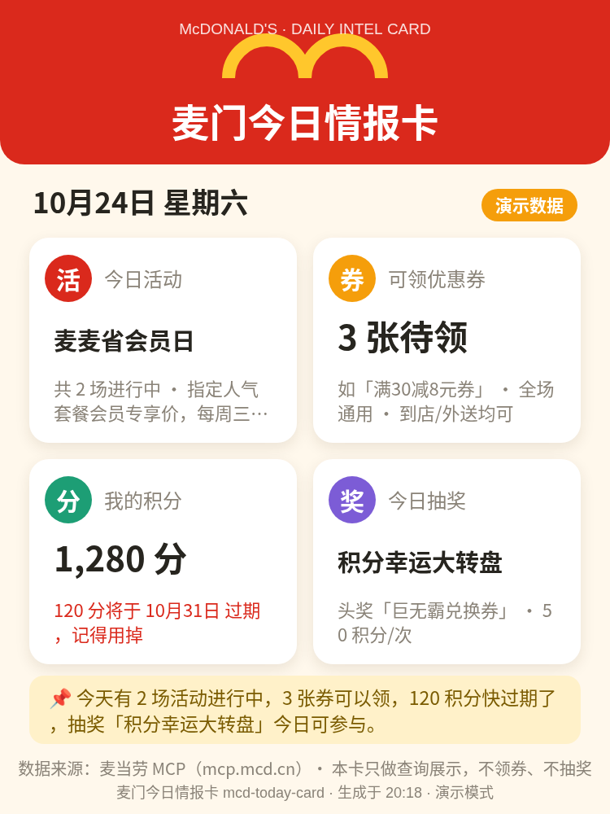

# 🍔 麦门今日情报卡

**每天打开麦当劳 App 之前，先看这一张卡：今天有什么活动、哪些券能领、我的积分哪天过期、抽奖值不值得看。**

一张竖版「今日情报卡」，聚合麦当劳 MCP 的四路真实数据，生成就能下载晒图。再也不怕券躺在包里过期、积分悄悄清零了。

<!-- 📸 效果截图位：把演示模式生成的卡片截图保存为 assets/card-demo.png 后，下面的图片会自动显示 -->

> 截图位置说明：将演示卡截图保存为 `assets/card-demo.png` 即可替换此处（当前为占位，仓库内打开页面点「演示模式」30 秒即可亲手生成一张）。

## ✨ 在线体验（30 秒，零门槛）

- **GitHub Pages**：本仓库开启 Pages 后即可在线打开（或把仓库下载到本地，静态服务器打开 `index.html`）。
- **演示模式**：不用任何 Token —— 打开页面点「演示模式」（或访问 `index.html?demo=1`），立即用样例数据生成一张完整卡片，右上角标注「演示数据」。
- **真实模式**：在页面顶部粘贴你自己的麦当劳 MCP Token（获取方式见下），点「生成今日卡」，四路真实数据一次聚合。

## 🎴 卡片里有什么

| 格子 | 内容 | 数据来源（MCP 工具） |
| --- | --- | --- |
| 🎉 今日活动 | 正在进行的主推活动 + 活动场次 | `campaign-calendar` + `now-time-info` |
| 🎟️ 可领优惠券 | 可领券张数 + 首张券名与条件 | `available-coupons` |
| ⭐ 我的积分 | 可用积分 + **即将过期积分红色提醒** | `query-my-account` |
| 🎁 今日抽奖 | 抽奖活动名、奖品与单次成本（只看不抽） | `query-lottery-info` |
| 📌 今日一句话 | 四路情报自动汇总成一句提醒 | 本地聚合 |

底部「⬇ 下载图片分享」一键导出 PNG（750×1000），发朋友圈 / 小红书 / 群聊都合适。

## 🔌 真实调用麦当劳 MCP

- 端点：`https://mcp.mcd.cn`（Streamable HTTP + JSON-RPC 2.0），浏览器 `fetch` 纯前端直连，**没有后端**；
- 流程：`initialize` 握手 → 保存 `Mcp-Session-Id` 会话头 → `notifications/initialized` → 5 次 `tools/call` 并行查询；
- **只查询、零写操作**：刻意不调用 `draw-lottery`（抽奖耗积分）和 `auto-bind-coupons`（一键领券）——情报卡只负责告诉你有什么，动不动手你说了算；
- Token 只存在你本机浏览器的 localStorage，不经过任何第三方服务器；单个工具失败时其余格子照常出卡，失败格显示「暂时取不到」；
- 接入细节（请求/响应结构、字段归一化、容错策略）见 [MCP_INTEGRATION.md](MCP_INTEGRATION.md)。

### 获取你自己的 Token（约 2 分钟）

1. 打开 https://open.mcd.cn/mcp ，点右上角「控制台」；
2. 手机号验证码登录；
3. 点「申请 MCP Token」，同意服务协议后一键复制；
4. 回到本页面，粘贴到顶部输入框 → 保存 → 生成今日卡。

> 配置文件形式可参考 [mcp-config.example.json](mcp-config.example.json)（只有占位符，没有真实凭证）。

## 🚀 快速开始

```bash
# 方式一：任意静态服务器
npx serve .
# 或
python3 -m http.server 8000
# 然后打开 http://localhost:8000

# 方式二：直接双击 index.html 也能进演示模式
# （真实模式需要 http(s) 环境以便浏览器直连 MCP）
```

零依赖、零构建：`index.html` + `app.js` + `demo-data.js` 三个文件就是全部。

## 👥 目标用户

- 麦当劳常客：每天纠结「今天有什么羊毛」的麦门信徒；
- 积分/优惠券总过期的人：到期提醒一眼可见；
- 想晒点什么的人：每日一卡，打卡式分享。

## 📁 文件结构

```
├── index.html              # 单页应用（页面 + 样式）
├── app.js                  # MCP 客户端 + 数据归一化 + Canvas 卡片绘制
├── demo-data.js            # 演示模式样例数据（结构模拟真实工具返回）
├── MCP_INTEGRATION.md      # MCP 集成说明（工具清单 / 请求响应 / 容错）
├── mcp-config.example.json # 脱敏配置示例（仅占位符）
├── CONTEST_DECLARATION.md  # 大赛官方参赛声明（原文）
└── assets/                 # 效果截图
```

## 🏆 关于比赛

本项目为**麦当劳程序员节创意开发大赛（M-CODE）**参赛作品，由参赛者独立开发，非麦当劳官方产品。餐品、活动与优惠信息以麦当劳官方渠道实时结果为准。

觉得这张卡有点意思的话，欢迎点个 ⭐ —— 每天来生成一张，就是最好的支持。
